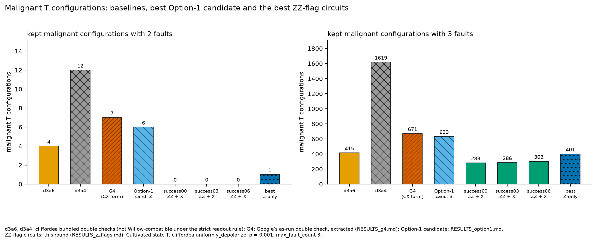
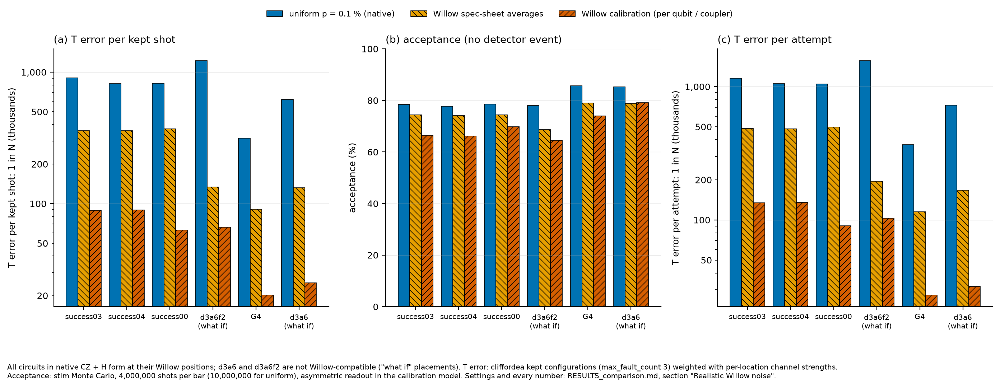
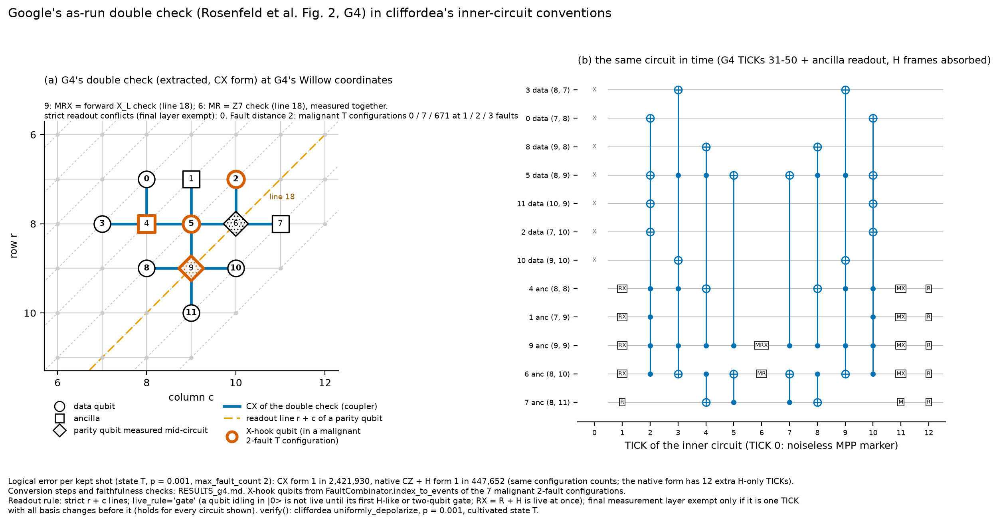
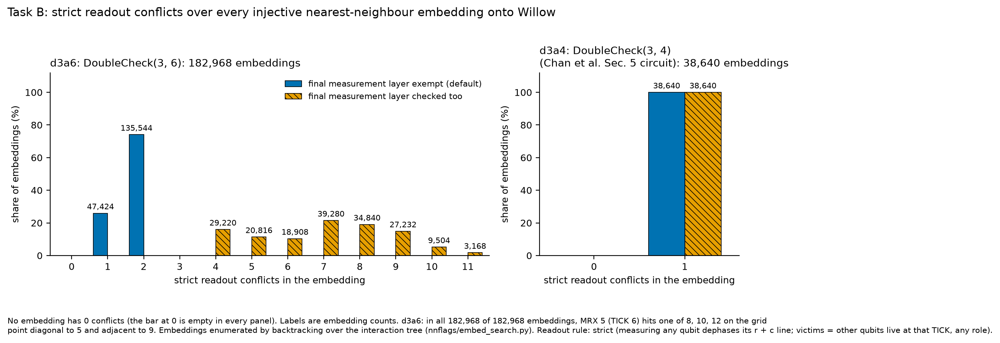
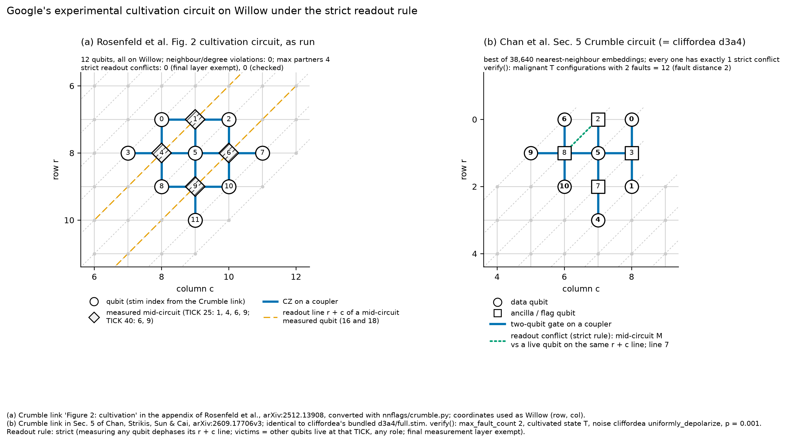
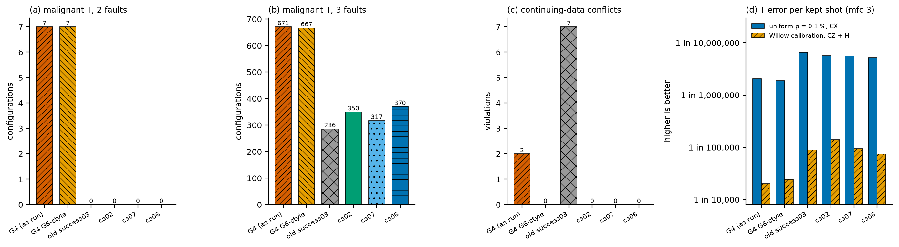
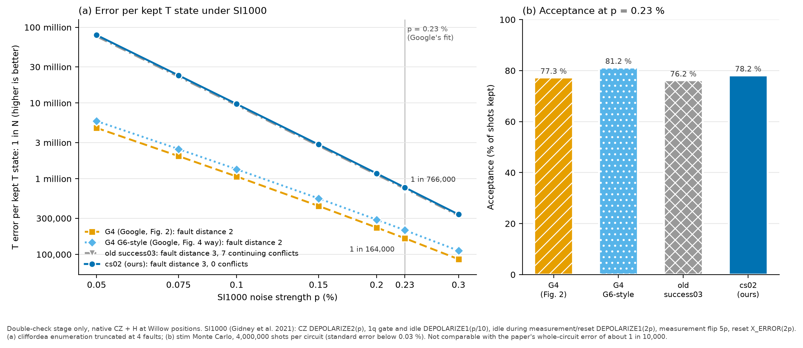

# What our work improves (status: Nov 1, 2026, 10:40 pm KST)

Open in VS Code with **Ctrl+Shift+V** (Markdown preview) to see the figures.

---

## 1. Fault distance 3 with nearest-neighbour gates on Willow's grid

Chan et al.'s fix (d3a6f2) restores fault distance 3, but it needs gates between non-neighbours and a qubit with 6 partners, so it cannot be placed on Willow. They state this as an open question: *"it would be interesting to devise a qubit layout that maintains nearest-neighbour connectivity."*

Our circuit **success03** reaches **fault distance 3** with:
- **only nearest-neighbour gates**;
- at most 3 partners per qubit;
- the real 105-qubit Willow grid.

It uses a **ZZ flag on a diagonal pair** (qubit 11) and an **X flag** (qubit 12).

*Middle panel: success03. Diamond = parity qubit measured mid-circuit; ▲ = ZZ flag; ▽ = X flag; orange dashed = the parity qubit's readout line.*

---

## 2. Fewer dangerous fault pairs than every baseline

| circuit | malignant pairs (2 faults) | fits Willow's grid |
|---|---|---|
| d3a6 (Chan et al., original) | 4 | no (readout rule) |
| d3a4 (Chan et al. Sec. 5) | 12 | no (readout rule) |
| G4 (Google, Rosenfeld et al. Fig. 2) | 7 | yes |
| **success03 (ours)** | **0** | yes (nearest-neighbour; see section 6) |

---

## 3. Lower error than Google's experimental circuit, under Willow noise

| Google QVM, Willow noise model (`willow_pink`) | G4 (Google) | success03 (ours) |
|---|---|---|
| T error per kept T state | 1 in 17,926 | **1 in 78,277 (4.4× better)** |
| acceptance | 75.1 % | 65.5 % (cost: about 10 % fewer kept shots) |

---

## 4. Independent validation with real T gates in Google's simulator

Every single fault and every pair of faults was injected with **real T gates** (qsim): 73,261 of 73,261 configurations agree with cliffordea.
- success03: **0** kept-and-corrupted pairs.
- G4: 7.
- d3a6: 4.

---

## 5. New findings about the existing circuits

- **Google's G4 has fault distance 2.** This refines Chan et al., who analysed the simplified d3a4.

- **d3a6 and d3a4 break Willow's readout rule in every possible layout** (182,968 and 38,640 layouts). Google's G4 avoids this by measuring on a clear readout line.

---

## 6. Solved: the readout rule when the data continue (search finished Nov 1, 10:12 pm KST)

**The problem.** In real cultivation the data qubits continue into escape / grafting, so the end-of-circuit flag and ancilla measurements are **mid-circuit for the data**.
- Under that rule, the old success03 has **7 conflicts** (`RESULTS_continuing_data.md`), and G4 has 2.

**Google's recipe.** Google's grafting circuit G6 avoids this. Data qubits sit on one line parity (lines 9 / 11 / 13) and all measured qubits on the other (10 / 12). The one ancilla stuck on a data line is never read out.

**Our result.** A new search with this rule as a hard constraint found **10 circuits (cs00–cs09)**.
- All 10 keep fault distance 3 and have **0 conflicts even when the data continue**.
- All use 12–13 qubits, with every ancilla read out.
- They all use **fold depth 5**; no shorter tree works.
- The best is **cs02** (12 qubits, one ZZ flag + one X flag).

| circuit | fault distance | conflicts when data continue | error per kept T state, uniform p = 0.1 % | Willow calibration noise | Google QVM (Willow noise) |
|---|---|---|---|---|---|
| G4 (Google, as run in Fig. 2) | 2 | 2 | 1 in 2.05 million | 1 in 20,234 | 1 in 18,460 |
| **G4 G6-style** (as Google runs it in Fig. 4: q7 not measured) | 2 | 0 | 1 in 1.87 million | 1 in 24,121 | 1 in 20,832 |
| old success03 | 3 | **7** | 1 in 6.57 million | 1 in 89,151 | 1 in 78,277 |
| **cs02 (new)** | **3** | **0** | 1 in 5.68 million | **1 in 140,288** | **1 in 121,322** |

**Google QVM checks on cs02:**
- the device check passes;
- real-T correctness passes;
- fault injection with real T gates agrees with cliffordea on all 1,203 single faults and all 13,041 fault pairs, with no kept-and-corrupted case.

QVM column: real T gates, `willow_pink` noise; cs02 8,000,000 shots (42 errors, 95 % CI 1 in 89,754 to 1 in 168,336), G4 G6-style and G4 also 8,000,000 shots (221 and 239 errors), so every circuit has the same number of shots. Full table with ratio CIs: `qvm-google (main)/MASTER_RESULTS.md`. An earlier 4,000,000-shot cs02 run gave 1 in 141,545; the 8,000,000-shot value supersedes it (`qvm-google (main)/test2_cs02_continuing_data_vs_google/RESULTS.md`).

**Cost.** Acceptance is 89.3 % at uniform p = 0.1 % (1.12 attempts per kept T state) and 75.2 % in the QVM (Google's G4 G6-style: 76.7 %).

**Fair baseline when the data continue.** Google's paper uses the same G4-style double check in both Fig. 2 and Fig. 4. In Fig. 4 (G6, data continue) it simply does not measure the ancilla on a data line.
- That "G4 G6-style" circuit has 0 readout conflicts but still fault distance 2.
- Against it, cs02 is about **5.8× better in Google's QVM** with real T (1 in 121,322 vs 1 in 20,832; 95 % CI of the ratio 4.2× to 8.1×; 42 vs 221 errors in the same 8,000,000 shots) and **5.8× better** under Willow calibration noise in stim (1 in 140,288 vs 1 in 24,121).
- Against G4 as run in Fig. 2, cs02 is **6.6× better** in the QVM (1 in 121,322 vs 1 in 18,460; 95 % CI 4.7× to 9.1×).

Details: `RESULTS_continuing_search.md`. Naming: **cs00–cs09** = `results/continuing/success00–09`. They are different from the old `results/zz/success*`.

---

## 7. Under Google's own noise model (SI1000)

Rosenfeld et al. matched their experiment with the SI1000 noise model at p = 0.23 %. Under the same model:

| circuit | fault distance | conflicts when data continue | error per kept T state, p = 0.23 % | p = 0.1 % | acceptance, p = 0.23 % |
|---|---|---|---|---|---|
| G4 (Google, Fig. 2) | 2 | 2 | 1 in 164,000 | 1 in 1.07 million | 77.3 % |
| G4 G6-style (Google, Fig. 4 way) | 2 | 0 | 1 in 209,000 | 1 in 1.33 million | 81.2 % |
| old success03 | 3 | 7 | 1 in 737,000 | 1 in 9.32 million | 76.2 % |
| **cs02 (ours)** | **3** | **0** | **1 in 766,000** | **1 in 9.71 million** | **78.2 %** |

- **At p = 0.23 %**, cs02 has about **4.7× lower error than G4** and **3.7× lower than G4 G6-style**, at about the same acceptance.
- **At p = 0.1 %** the gap grows to **9.1×** and **7.3×**. The slopes in panel (a) show why: our circuit's error falls like p³ (fault distance 3) and Google's like p² (fault distance 2), so the better the hardware, the more the design helps.
- **Scope.** These are double-check-stage numbers (cliffordea, up to 4 faults). They are not comparable with the paper's whole-circuit error of about 1 in 10,000.
- Code: `nnflags/si1000.py`, `nnflags/plots_si1000.py`. Data: `results/si1000.json`, `results/si1000_sweep.json`.

---

## One-line summary

> We restored fault distance 3 for T-state cultivation on Willow's nearest-neighbour grid, answering Chan et al.'s open question. Our best circuit, cs02, also keeps data and measured qubits on separate readout lines, so it stays valid when the data continue into escape, as Google's grafting experiment requires. In Google's own QVM with real T gates it has about **5.8× lower error per kept T state than Google's double check run in its continuing (Fig. 4) style** (1 in 121,322 vs 1 in 20,832, 95 % CI 4.2× to 8.1×, the same 8,000,000 shots each), at about the same acceptance (75.2 % vs 76.7 %), and 6.6× lower than the circuit as run in Fig. 2 (1 in 18,460). A variant that fits Google's grafting layout (G6-fit #0) is 3.4× better (1 in 70,284, 95 % CI 2.6× to 4.4×) at 71.4 % acceptance.

---

## 8. Fitting Google's grafting experiment (G6, Fig. 4)

cs02 cannot replace Google's double check inside G6: G6's grafting needs the data on G6's positions with G6's code, and no placement of cs02 has a free grid point for all of its ancillas and flags. A search with the data and code fixed to G6's found **9 fault-distance-3 circuits** (13-15 qubits). All 9 pass Google's device check and real-T fault injection in the QVM, and have **2.4-4.1× lower error** than Google's double check (8,000,000 shots each; every ratio's 95 % CI stays above 1.9×), at 62-72 % acceptance (Google 76.7 %). Their errors are statistically close (overlapping CIs); acceptance separates them. The chosen one, **#0** (13 qubits, ZZ + X flags), has 1 in 70,284 per kept T state (3.4×, 95 % CI 2.6× to 4.4×) at 71.4 % acceptance; #1 is statistically tied with it (1 in 71,364, 71.7 %). Details: `qvm-google (main)/test3_full_qec_realT_lowT_sim_ours_vs_google_g6/` (README, `RESULTS_qvm_g6fit.md`).

---

Detailed reports: `RESULTS_zzflags.md`, `RESULTS_comparison.md`, `qvm-google (main)/test1_fd3_circuits_vs_google_fig2/RESULTS.md`, `RESULTS_continuing_data.md`.
