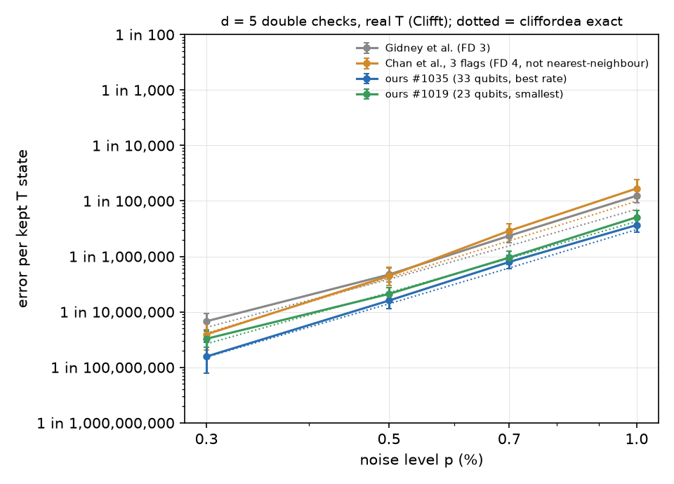

# Test 5, B3: independent real-T check of the d = 5 circuits by sampling (written Nov 05, 08:55 AM KST)

Clifft (exact near-Clifford, real T) with cliffordea's own uniform depolarising noise at each p; ideal T_L in, ideal decode. Compared with cliffordea's exact enumeration at the same p.

| circuit | p | shots | acceptance | errors / kept in code | Clifft: error per kept T state (95 % CI) | cliffordea (exact, to k faults) |
|---|---|---|---|---|---|---|
| Gidney et al. (FD 3) | 0.3 % | 3,000,000,000 | 31.8 % | 37 / 546,347,054 | 1 in 14,766,137 (1 in 10,712,766 to 1 in 20,971,877) | 1 in 19,034,383 (k = 5) |
| Gidney et al. (FD 3) | 0.5 % | 1,800,000,000 | 15.1 % | 50 / 106,284,802 | 1 in 2,125,696 (1 in 1,612,360 to 1 in 2,863,973) | 1 in 2,581,131 (k = 5) |
| Gidney et al. (FD 3) | 0.7 % | 1,100,000,000 | 7.3 % | 50 / 21,236,996 | 1 in 424,740 (1 in 322,169 to 1 in 572,256) | 1 in 645,710 (k = 5) |
| Gidney et al. (FD 3) | 1.0 % | 1,100,000,000 | 2.5 % | 50 / 4,030,128 | 1 in 80,603 (1 in 61,138 to 1 in 108,597) | 1 in 140,720 (k = 5) |
| Chan et al., 3 flags (FD 4, not nearest-neighbour) | 0.3 % | 3,000,000,000 | 19.7 % | 12 / 304,972,004 | 1 in 25,414,334 (1 in 14,549,091 to 1 in 49,184,470) | 1 in 24,193,019 (k = 5) |
| Chan et al., 3 flags (FD 4, not nearest-neighbour) | 0.5 % | 3,000,000,000 | 6.9 % | 30 / 67,579,481 | 1 in 2,252,649 (1 in 1,577,970 to 1 in 3,338,763) | 1 in 2,443,498 (k = 5) |
| Chan et al., 3 flags (FD 4, not nearest-neighbour) | 0.7 % | 3,000,000,000 | 2.5 % | 44 / 15,196,373 | 1 in 345,372 (1 in 257,269 to 1 in 475,325) | 1 in 524,139 (k = 5) |
| Chan et al., 3 flags (FD 4, not nearest-neighbour) | 1.0 % | 3,000,000,000 | 0.6 % | 28 / 1,668,341 | 1 in 59,584 (1 in 41,227 to 1 in 89,668) | 1 in 100,856 (k = 5) |
| ours #1035 (33 qubits, best rate) | 0.3 % | 3,000,000,000 | 45.5 % | 11 / 702,386,446 | 1 in 63,853,313 (1 in 35,686,672 to 1 in 127,912,207) | 1 in 65,495,571 (k = 5) |
| ours #1035 (33 qubits, best rate) | 0.5 % | 3,000,000,000 | 27.4 % | 43 / 268,693,533 | 1 in 6,248,687 (1 in 4,638,988 to 1 in 8,634,301) | 1 in 7,150,524 (k = 5) |
| ours #1035 (33 qubits, best rate) | 0.7 % | 1,900,000,000 | 16.7 % | 52 / 65,495,222 | 1 in 1,259,524 (1 in 960,466 to 1 in 1,686,452) | 1 in 1,616,866 (k = 5) |
| ours #1035 (33 qubits, best rate) | 1.0 % | 1,700,000,000 | 8.1 % | 52 / 14,154,178 | 1 in 272,196 (1 in 207,567 to 1 in 364,459) | 1 in 327,393 (k = 5) |
| ours #1019 (23 qubits, smallest) | 0.3 % | 3,000,000,000 | 74.1 % | 40 / 1,222,215,306 | 1 in 30,555,383 (1 in 22,438,878 to 1 in 42,769,814) | 1 in 37,722,676 (k = 5) |
| ours #1019 (23 qubits, smallest) | 0.5 % | 1,100,000,000 | 61.1 % | 52 / 246,877,985 | 1 in 4,747,654 (1 in 3,620,385 to 1 in 6,356,922) | 1 in 4,497,209 (k = 5) |
| ours #1019 (23 qubits, smallest) | 0.7 % | 500,000,000 | 50.8 % | 59 / 61,951,624 | 1 in 1,050,028 (1 in 814,021 to 1 in 1,379,353) | 1 in 1,083,851 (k = 5) |
| ours #1019 (23 qubits, smallest) | 1.0 % | 200,000,000 | 38.9 % | 52 / 10,206,858 | 1 in 196,286 (1 in 149,680 to 1 in 262,819) | 1 in 234,267 (k = 5) |

## Slope of log(error) vs log(p) (fault distance: slope -> FD as p -> 0)

| circuit | fitted slope (points with >= 5 errors) |
|---|---|
| Gidney et al. (FD 3) | 4.34 |
| Chan et al., 3 flags (FD 4, not nearest-neighbour) | 5.06 |
| ours #1035 (33 qubits, best rate) | 4.55 |
| ours #1019 (23 qubits, smallest) | 4.19 |

At these p, higher-order terms still matter, so the fitted slopes sit between the fault distance and the next order; what matters is the comparison between circuits and the agreement with cliffordea.

