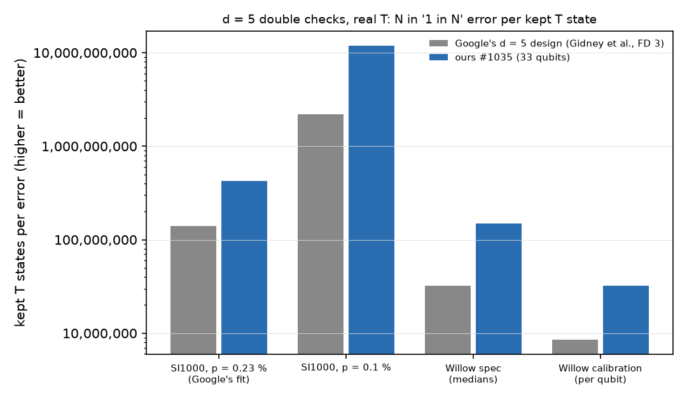

# Test 5, B4: d = 5 double checks under realistic noise, real T (written Nov 06, 09:36 AM KST)

Error per kept T state: cliffordea exact enumeration with real T, up to 4 faults for the ranking of all circuits and up to 5 faults for the references and our best three (marked per row) (agrees with Clifft sampling, B3). Acceptance: stim Monte Carlo (2,000,000 shots). Native CZ + H circuits.

## SI1000, p = 0.23 % (Google's fit)

| circuit | error per kept T state | acceptance | ours better than Google by |
|---|---|---|---|
| Google's d = 5 design (Gidney et al., FD 3) (to 4 faults) | 1 in 140,644,989 | 46.7 % | 1.0x |
| ours #1035 (33 qubits) (to 4 faults) | 1 in 422,728,848 | 57.1 % | 3.0x |
| ours #1033 (33 qubits) (to 4 faults) | 1 in 403,427,255 | 56.7 % | 2.9x |
| ours #1031 (32 qubits) (to 4 faults) | 1 in 391,327,898 | 57.1 % | 2.8x |
| ours #1004 (29 qubits) (to 4 faults) | 1 in 368,998,207 | 63.6 % | 2.6x |
| ours #1036 (29 qubits) (to 4 faults) | 1 in 364,155,745 | 65.4 % | 2.6x |
| ours #1017 (30 qubits) (to 4 faults) | 1 in 348,459,467 | 60.2 % | 2.5x |

## SI1000, p = 0.1 %

| circuit | error per kept T state | acceptance | ours better than Google by |
|---|---|---|---|
| Google's d = 5 design (Gidney et al., FD 3) (to 4 faults) | 1 in 2,189,785,023 | 71.7 % | 1.0x |
| ours #1035 (33 qubits) (to 4 faults) | 1 in 11,811,102,444 | 78.2 % | 5.4x |
| ours #1033 (33 qubits) (to 4 faults) | 1 in 11,272,279,175 | 78.1 % | 5.1x |
| ours #1031 (32 qubits) (to 4 faults) | 1 in 10,941,928,096 | 78.3 % | 5.0x |
| ours #1004 (29 qubits) (to 4 faults) | 1 in 10,333,552,572 | 82.0 % | 4.7x |
| ours #1036 (29 qubits) (to 4 faults) | 1 in 10,201,313,221 | 83.0 % | 4.7x |
| ours #1017 (30 qubits) (to 4 faults) | 1 in 9,759,172,403 | 80.1 % | 4.5x |

## Willow spec (medians)

| circuit | error per kept T state | acceptance | ours better than Google by |
|---|---|---|---|
| Google's d = 5 design (Gidney et al., FD 3) (to 4 faults) | 1 in 32,258,866 | 44.0 % | 1.0x |
| ours #1035 (33 qubits) (to 4 faults) | 1 in 148,371,537 | 55.8 % | 4.6x |
| ours #1033 (33 qubits) (to 4 faults) | 1 in 117,025,221 | 55.4 % | 3.6x |
| ours #1031 (32 qubits) (to 4 faults) | 1 in 115,603,875 | 54.9 % | 3.6x |
| ours #1004 (29 qubits) (to 4 faults) | 1 in 118,338,144 | 62.1 % | 3.7x |
| ours #1036 (29 qubits) (to 4 faults) | 1 in 131,347,499 | 64.9 % | 4.1x |
| ours #1017 (30 qubits) (to 4 faults) | 1 in 100,257,669 | 57.9 % | 3.1x |

## Willow calibration (per qubit)

| circuit | error per kept T state | acceptance | ours better than Google by |
|---|---|---|---|
| Google's d = 5 design (Gidney et al., FD 3) (to 4 faults) | 1 in 8,550,839 | 39.2 % | 1.0x |
| ours #1035 (33 qubits) (to 4 faults) | 1 in 32,285,448 | 52.9 % | 3.8x |
| ours #1033 (33 qubits) (to 4 faults) | 1 in 30,823,716 | 52.1 % | 3.6x |
| ours #1031 (32 qubits) (to 4 faults) | 1 in 46,903,560 | 52.3 % | 5.5x |
| ours #1004 (29 qubits) (to 4 faults) | 1 in 18,466,780 | 56.8 % | 2.2x |
| ours #1036 (29 qubits) (to 4 faults) | 1 in 26,208,832 | 60.9 % | 3.1x |
| ours #1017 (30 qubits) (to 4 faults) | 1 in 27,497,639 | 52.8 % | 3.2x |

Google's design = Gidney et al.'s d = 5 double check (it does not satisfy Willow's readout rule on any placement, B1). Chan et al.'s flagged d5a19f3 was also computed (results/b4/b4.json) but is not shown: it cannot run on Willow.

## All 41 of our circuits, SI1000 p = 0.23 % (sorted)

| circuit | error per kept T state | acceptance | Willow calibration |
|---|---|---|---|
| ours #1035 (33 qubits) | 1 in 422,728,848 | 57.1 % | 1 in 32,285,448 |
| ours #1033 (33 qubits) | 1 in 403,427,255 | 56.7 % | 1 in 30,823,716 |
| ours #1031 (32 qubits) | 1 in 391,327,898 | 57.1 % | 1 in 46,903,560 |
| ours #1004 (29 qubits) | 1 in 368,998,207 | 63.6 % | 1 in 18,466,780 |
| ours #1036 (29 qubits) | 1 in 364,155,745 | 65.4 % | 1 in 26,208,832 |
| ours #1017 (30 qubits) | 1 in 348,459,467 | 60.2 % | 1 in 27,497,639 |
| ours #1005 (30 qubits) | 1 in 337,465,911 | 62.2 % | 1 in 20,536,902 |
| ours #1006 (28 qubits) | 1 in 333,376,471 | 64.8 % | 1 in 32,909,089 |
| ours #1029 (32 qubits) | 1 in 328,603,333 | 58.1 % | 1 in 18,257,152 |
| ours #1021 (25 qubits) | 1 in 323,658,261 | 72.5 % | 1 in 16,795,302 |
| ours #1011 (28 qubits) | 1 in 322,834,074 | 64.0 % | 1 in 16,760,248 |
| ours #1014 (31 qubits) | 1 in 321,536,731 | 59.1 % | 1 in 3,973,204 |
| ours #1002 (31 qubits) | 1 in 308,891,485 | 57.8 % | 1 in 18,503,828 |
| ours #1028 (30 qubits) | 1 in 296,851,790 | 61.4 % | 1 in 14,044,924 |
| ours #1018 (29 qubits) | 1 in 296,616,471 | 63.0 % | 1 in 23,035,317 |
| ours #1039 (33 qubits) | 1 in 296,614,276 | 57.2 % | 1 in 17,386,802 |
| ours #1013 (30 qubits) | 1 in 295,182,998 | 61.2 % | 1 in 14,388,422 |
| ours #1037 (24 qubits) | 1 in 286,379,278 | 74.7 % | 1 in 11,235,849 |
| ours #1008 (31 qubits) | 1 in 262,132,668 | 59.7 % | 1 in 23,973,947 |
| ours #1023 (30 qubits) | 1 in 254,817,662 | 61.5 % | 1 in 18,033,638 |
| ours #1000 (29 qubits) | 1 in 250,254,108 | 64.5 % | 1 in 19,705,518 |
| ours #1038 (24 qubits) | 1 in 234,286,040 | 75.0 % | 1 in 12,173,918 |
| ours #1019 (23 qubits) | 1 in 227,807,383 | 78.0 % | 1 in 9,474,188 |
| ours #1007 (26 qubits) | 1 in 226,497,742 | 70.9 % | 1 in 5,861,821 |
| ours #1001 (23 qubits) | 0 | 0.0 % | 0 |
| ours #1003 (30 qubits) | 0 | 0.0 % | 0 |
| ours #1009 (25 qubits) | 0 | 0.0 % | 0 |
| ours #1010 (33 qubits) | 0 | 0.0 % | 0 |
| ours #1012 (25 qubits) | 0 | 0.0 % | 0 |
| ours #1015 (24 qubits) | 0 | 0.0 % | 0 |
| ours #1016 (28 qubits) | 0 | 0.0 % | 0 |
| ours #1020 (25 qubits) | 0 | 0.0 % | 0 |
| ours #1022 (25 qubits) | 0 | 0.0 % | 0 |
| ours #1024 (25 qubits) | 0 | 0.0 % | 0 |
| ours #1025 (26 qubits) | 0 | 0.0 % | 0 |
| ours #1026 (23 qubits) | 0 | 0.0 % | 0 |
| ours #1027 (24 qubits) | 0 | 0.0 % | 0 |
| ours #1030 (24 qubits) | 0 | 0.0 % | 0 |
| ours #1032 (29 qubits) | 0 | 0.0 % | 0 |
| ours #1034 (23 qubits) | 0 | 0.0 % | 0 |
| ours #1040 (27 qubits) | 0 | 0.0 % | 0 |

Notes: Gidney's circuit is placed on Willow at its least-violating placement but breaks the readout rule there (B1). Only our circuits run on Willow as they are. Willow calibration results depend on the chip region of the placement.

