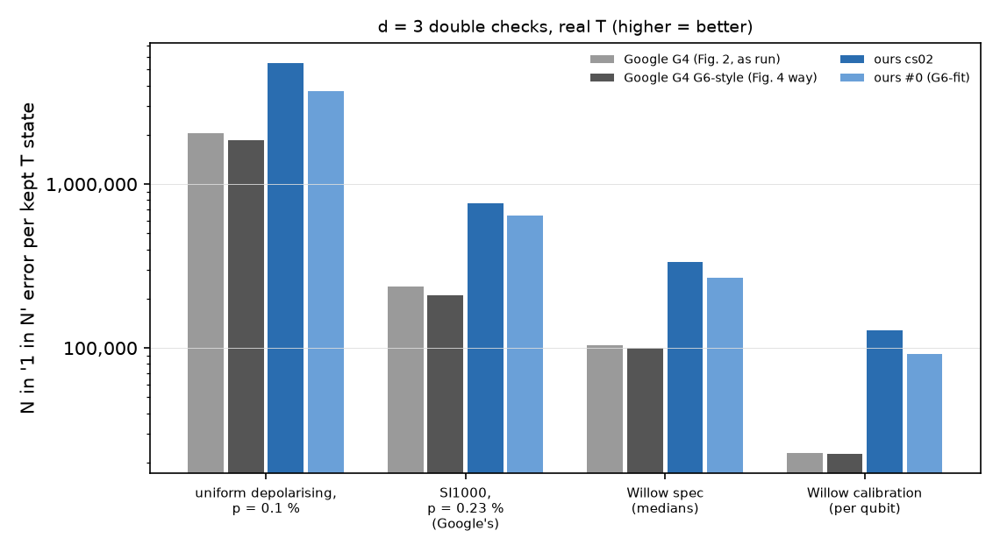
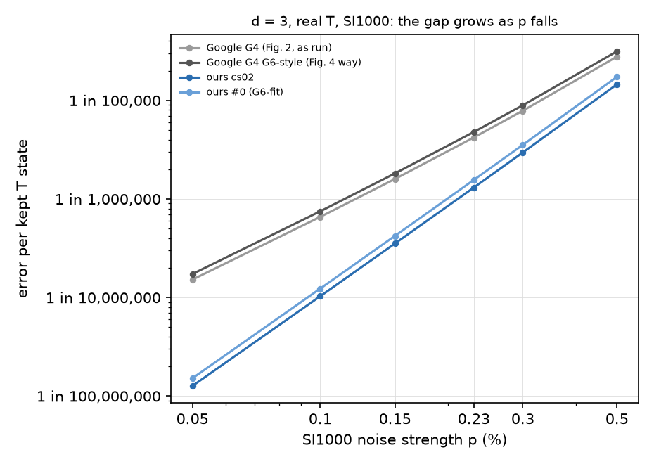
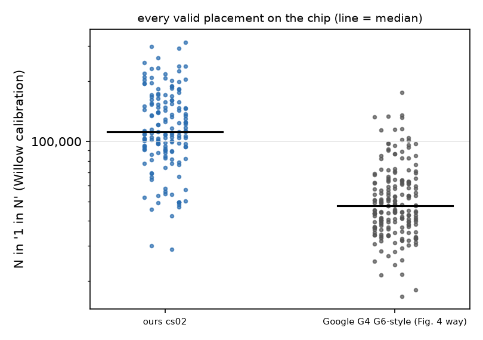

# Test 7: cs02 (d = 3) against Google's d = 3 double checks on Willow (written Nov 06, 09:36 AM KST)

Error per kept T state: cliffordea exact enumeration with real T (up to 4 faults); acceptance: stim Monte Carlo (2,000,000 shots). Native CZ + H circuits.

## A. uniform depolarising, p = 0.1 %

| circuit | error per kept T state | acceptance | cs02 is better by |
|---|---|---|---|
| Google G4 (Fig. 2, as run) | 1 in 2,047,233 | 93.1 % | 2.7x |
| Google G4 G6-style (Fig. 4 way) | 1 in 1,863,139 | 93.4 % | 3.0x |
| ours cs02 | 1 in 5,504,576 | 89.3 % |  |
| ours #0 (G6-fit) | 1 in 3,708,434 | 86.1 % | 1.5x |

## A. SI1000, p = 0.23 % (Google's)

| circuit | error per kept T state | acceptance | cs02 is better by |
|---|---|---|---|
| Google G4 (Fig. 2, as run) | 1 in 237,812 | 79.8 % | 3.2x |
| Google G4 G6-style (Fig. 4 way) | 1 in 209,037 | 81.2 % | 3.7x |
| ours cs02 | 1 in 765,869 | 78.3 % |  |
| ours #0 (G6-fit) | 1 in 640,910 | 75.6 % | 1.2x |

## A. Willow spec (medians)

| circuit | error per kept T state | acceptance | cs02 is better by |
|---|---|---|---|
| Google G4 (Fig. 2, as run) | 1 in 103,784 | 80.2 % | 3.2x |
| Google G4 G6-style (Fig. 4 way) | 1 in 99,859 | 81.2 % | 3.4x |
| ours cs02 | 1 in 336,453 | 76.2 % |  |
| ours #0 (G6-fit) | 1 in 268,934 | 73.5 % | 1.3x |

## A. Willow calibration (per qubit)

| circuit | error per kept T state | acceptance | cs02 is better by |
|---|---|---|---|
| Google G4 (Fig. 2, as run) | 1 in 22,935 | 73.7 % | 5.6x |
| Google G4 G6-style (Fig. 4 way) | 1 in 22,551 | 74.8 % | 5.7x |
| ours cs02 | 1 in 128,163 | 73.9 % |  |
| ours #0 (G6-fit) | 1 in 91,752 | 68.5 % | 1.4x |

Only circuits that run on Willow are compared (Google's two versions and ours). Gidney's original d3a6 and Chan et al.'s flagged d3a6f2 were also computed (results/t7.json) but are not shown: neither can run on Willow (readout rule / non-nearest-neighbour gates).

## B. SI1000 sweep

| circuit | p = 0.05 % | p = 0.1 % | p = 0.15 % | p = 0.23 % | p = 0.3 % | p = 0.5 % | slope (p <= 0.23 %) |
|---|---|---|---|---|---|---|---|
| Google G4 (Fig. 2, as run) | 1 in 6,583,239 | 1 in 1,520,331 | 1 in 626,560 | 1 in 237,812 | 1 in 127,301 | 1 in 35,990 | 2.17 |
| Google G4 G6-style (Fig. 4 way) | 1 in 5,772,643 | 1 in 1,334,006 | 1 in 550,140 | 1 in 209,037 | 1 in 112,009 | 1 in 31,763 | 2.17 |
| ours cs02 | 1 in 78,963,741 | 1 in 9,711,392 | 1 in 2,831,644 | 1 in 765,869 | 1 in 337,710 | 1 in 68,690 | 3.04 |
| ours #0 (G6-fit) | 1 in 66,034,700 | 1 in 8,122,473 | 1 in 2,368,775 | 1 in 640,910 | 1 in 282,719 | 1 in 57,588 | 3.04 |

Fault distance 2 gives slope -> 2 and fault distance 3 gives slope -> 3 as p -> 0.

## C. Chip positions (Willow calibration, every placement keeping the continuing-data rule)

| circuit | placements | best | median | worst |
|---|---|---|---|---|
| ours cs02 | 160 | 1 in 314,443 | 1 in 111,425 | 1 in 28,870 |
| Google G4 G6-style (Fig. 4 way) | 196 | 1 in 175,366 | 1 in 47,451 | 1 in 16,726 |

Median gain cs02 vs Google G4 G6-style over the chip: 2.3x; cs02's WORST placement vs Google's BEST: 0.2x.

